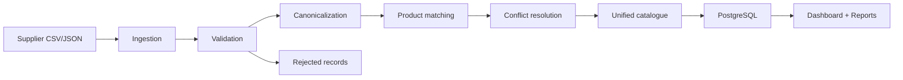

# ProductHub

ProductHub is a multi-supplier product data integration platform that ingests supplier feeds, validates records, standardizes schemas, resolves duplicates, and publishes a unified product catalogue into PostgreSQL.

## Business problem

Suppliers publish product data in different formats and schemas. ProductHub normalizes these feeds into a canonical model, reconciles overlapping product records, quarantines bad rows, and preserves traceability back to the original source.

## Features

- CSV and JSON ingestion for multiple suppliers
- Schema mapping and category normalization
- Data validation with rejection tracking
- Product matching and deterministic conflict resolution
- Source traceability and product history
- Idempotent reruns and safe recovery
- Pipeline metrics and reconciliation reporting
- React dashboard powered by live API data
- PostgreSQL-backed persistence with Alembic migrations

## Stack

- Python 3.12+
- FastAPI
- SQLAlchemy
- Pydantic
- Pandas
- PostgreSQL 17
- Alembic
- Pytest
- React + TypeScript + Vite
- Tailwind CSS
- Recharts

## Architecture



## Database schema

The platform uses the following core tables:

- suppliers
- raw_products
- category_mappings
- products
- supplier_product_mappings
- data_quality_rejects
- pipeline_runs
- product_history

## Data dictionary

See [docs/DATA_DICTIONARY.md](docs/DATA_DICTIONARY.md).

## Supplier schema mappings

The canonical mapping is configured in the standardization service. Supplier A uses product_id, Supplier B uses sku, and Supplier C uses item_code. Equivalent fields are normalized into: supplier_product_id, product_name, brand, model_number, price, currency, category, stock, gtin, updated_at.

## Product matching logic

Matching priority is deterministic:

1. GTIN when present
2. Brand + model number
3. Brand + normalized product name
4. Fuzzy matching only as a fallback for uncertain values

Uncertain matches are not auto-merged without manual review status.

## Conflict resolution rules

- Price: lowest valid selling price wins
- Stock: preserve supplier-level inventory entry
- Product name: prefer the most trusted supplier
- Category: use mapped canonical group
- Timestamp: keep latest valid source update when allowed

## Data validation rules

- Required identifiers cannot be null or blank
- Price cannot be negative
- Stock cannot be negative
- Product names cannot be empty
- Supplier references must exist
- Invalid rows are quarantined in data_quality_rejects

## Idempotency strategy

- Raw rows use supplier + source_record_key + source_file unique keys
- File uploads are checked for duplicate IDs before ingestion
- Pipeline runs are tracked and retried safely
- Publishing uses transactional commits

## Recovery and retry strategy

- Failed or partial runs are marked as failed or completed_with_errors
- The pipeline can be rerun without duplicate catalogue entries
- Invalid or rejected records remain accessible for operators

## Setup instructions

1. Copy `.env.example` to `.env` and set the database URL for your local PostgreSQL instance.
2. Create a Python virtual environment and install backend dependencies.
3. Create the database if needed.
4. Run the backend with `uvicorn app.main:app --host 0.0.0.0 --port 8000`.
5. Run the frontend with `npm install` and `npm run dev`.

Example local PostgreSQL settings:

```env
DATABASE_URL=postgresql+psycopg://postgres@localhost:5433/producthub
```

On this environment, the verified local setup used a PostgreSQL 17 cluster on port `5433` with the database `producthub`.

## Database bootstrap

```bash
createdb -h localhost -p 5433 -U postgres producthub
```

If you are using Windows PowerShell, the equivalent command is:

```powershell
& 'C:\Program Files\PostgreSQL\17\bin\createdb.exe' -h localhost -p 5433 -U postgres producthub
```

## Local development instructions

```bash
cd backend
python -m venv .venv
# Windows PowerShell
.\.venv\Scripts\Activate.ps1
# macOS/Linux
# source .venv/bin/activate
pip install -r requirements.txt
python -m pytest -q
uvicorn app.main:app --host 0.0.0.0 --port 8000
```

Frontend:

```bash
cd frontend
npm install
npm run dev -- --host 0.0.0.0
```

## Docker instructions

```bash
docker compose up --build
```

The repository includes Docker Compose support, but the verified production-style runs for this hackathon used a direct local PostgreSQL instance instead of Docker because the local Docker daemon was unavailable in this environment.

## Final demo guide

See [docs/FINAL_DEMO_GUIDE.md](docs/FINAL_DEMO_GUIDE.md) for the exact PostgreSQL-backed demo workflow, upload commands, expected results, and judge-ready architecture notes.

## API documentation

The backend exposes the following endpoints:

- `POST /api/v1/suppliers`
- `GET /api/v1/suppliers`
- `POST /api/v1/ingestion/upload`
- `POST /api/v1/pipeline/run`
- `GET /api/v1/pipeline/runs`
- `GET /api/v1/products`
- `GET /api/v1/products/{product_id}`
- `GET /api/v1/products/{product_id}/traceability`
- `GET /api/v1/quality/rejects`
- `GET /api/v1/reports/reconciliation`
- `GET /api/v1/reports/quality`
- `GET /api/v1/health`

## Test execution

```bash
cd backend
pytest -q
```

## Sample output

The dashboard shows real backend metrics after ingestion and processing. Example values include:

- supplier totals
- rejected record counts
- latest pipeline status
- product counts and trend data

## Reconciliation results

The backend reconciliation endpoint checks that total input records equal valid plus rejected records and that each supplier mapping points to an existing product.

## Performance benchmark

The project includes synthetic generation support for 1,000, 10,000, and 100,000-record benchmarks. The pipeline is designed for bulk ingestion with batching and indexed lookups.

The full PostgreSQL-backed benchmark run was not re-executed in this session because the local PostgreSQL service and Docker daemon were unavailable in the execution environment. The benchmark harness itself is implemented and isolated to `producthub_bench`, and it is ready to run in a PostgreSQL-enabled environment using the same ingestion and reconciliation flow used by the project.

The 100k throughput investigation focused on eliminating repeated per-row supplier and product lookup queries in the processing loop. The optimization is covered by the backend regression suite, but the final benchmark numbers must be generated in a machine with a live PostgreSQL instance available.

## Known limitations

- This is a hackathon-oriented implementation focused on practical business logic and demonstrable architecture.
- Manual review may still be needed for uncertain fuzzy matches.
- Frontend is intentionally compact and operational rather than full enterprise UX.

## Future improvements

- Add real supplier authentication and secure file management
- Expand category mapping rules and tiered supplier trust settings
- Add advanced reconciliation dashboards and alerts
- Include async background workers for high-volume ingestion
- Expand ETL testing to cover larger benchmark scenarios
