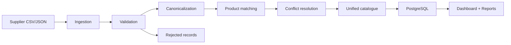

# ProductHub

### Multi-Supplier Product Data Integration & Standardization Platform

"Transform inconsistent product feeds from multiple suppliers into one unified, standardized and traceable product catalogue."

## 100,000 Records Successfully Processed and Reconciled

| Metric | Value |
| --- | ---: |
| Dataset size | 100,000 records |
| Processing time | 647.39 seconds |
| Throughput | 150.91 records/second |
| Reconciliation | Successful |

## 🚀 Project Highlights

- Multi-supplier ingestion: CSV and JSON feeds.
- Data standardization: convert different supplier schemas into a canonical product structure.
- Product matching: identify matching products across suppliers using GTIN and available product attributes.
- Conflict resolution: resolve conflicting supplier values using deterministic rules.
- Unified catalogue: publish standardized products.
- Data quality: identify invalid and duplicate records.
- Traceability: preserve original supplier payloads and source mappings.
- Reconciliation: track input, valid, rejected and processed records.

ProductHub solves a common supplier-data problem: each vendor delivers product information in a different shape, naming convention, and quality standard. The platform ingests those feeds, validates and standardizes them, matches overlapping products, resolves conflicts, and publishes one reliable product catalogue with full traceability back to the source.

## Business problem

Suppliers publish product data in different formats and schemas. ProductHub normalizes these feeds into a canonical model, reconciles overlapping product records, quarantines bad rows, and preserves traceability back to the original source.

## Features

- CSV and JSON ingestion for multiple suppliers
- Schema mapping and category normalization
- Data validation with rejection tracking
- Product matching and deterministic conflict resolution
- Source traceability and product history
- Idempotent reruns and safe recovery
- Pipeline metrics and reconciliation reporting
- React dashboard powered by live API data
- PostgreSQL-backed persistence with Alembic migrations

## Stack

- Python 3.12+
- FastAPI
- SQLAlchemy
- Pydantic
- Pandas
- PostgreSQL 17
- Alembic
- Pytest
- React + TypeScript + Vite
- Tailwind CSS
- Recharts

## Architecture



## Database schema

The platform uses the following core tables:

- suppliers
- raw_products
- category_mappings
- products
- supplier_product_mappings
- data_quality_rejects
- pipeline_runs
- product_history

## Data dictionary

See [docs/DATA_DICTIONARY.md](docs/DATA_DICTIONARY.md).

## Supplier schema mappings

The canonical mapping is configured in the standardization service. Supplier A uses product_id, Supplier B uses sku, and Supplier C uses item_code. Equivalent fields are normalized into: supplier_product_id, product_name, brand, model_number, price, currency, category, stock, gtin, updated_at.

## Product matching logic

Matching priority is deterministic:

1. GTIN when present
2. Brand + model number
3. Brand + normalized product name
4. Fuzzy matching only as a fallback for uncertain values

Uncertain matches are not auto-merged without manual review status.

## Conflict resolution rules

- Price: lowest valid selling price wins
- Stock: preserve supplier-level inventory entry
- Product name: prefer the most trusted supplier
- Category: use mapped canonical group
- Timestamp: keep latest valid source update when allowed

## Data validation rules

- Required identifiers cannot be null or blank
- Price cannot be negative
- Stock cannot be negative
- Product names cannot be empty
- Supplier references must exist
- Invalid rows are quarantined in data_quality_rejects

## Idempotency strategy

- Raw rows use supplier + source_record_key + source_file unique keys
- File uploads are checked for duplicate IDs before ingestion
- Pipeline runs are tracked and retried safely
- Publishing uses transactional commits

## Recovery and retry strategy

- Failed or partial runs are marked as failed or completed_with_errors
- The pipeline can be rerun without duplicate catalogue entries
- Invalid or rejected records remain accessible for operators

## Setup instructions

1. Copy `.env.example` to `.env` and set the database URL for your local PostgreSQL instance.
2. Create a Python virtual environment and install backend dependencies.
3. Create the database if needed.
4. Run the backend with `uvicorn app.main:app --host 0.0.0.0 --port 8000`.
5. Run the frontend with `npm install` and `npm run dev`.

Example local PostgreSQL settings:

```env
DATABASE_URL=postgresql+psycopg://postgres@localhost:5433/producthub
```

On this environment, the verified local setup used a PostgreSQL 17 cluster on port `5433` with the database `producthub`.

## Database bootstrap

```bash
createdb -h localhost -p 5433 -U postgres producthub
```

If you are using Windows PowerShell, the equivalent command is:

```powershell
& 'C:\Program Files\PostgreSQL\17\bin\createdb.exe' -h localhost -p 5433 -U postgres producthub
```

## Local development instructions

```bash
cd backend
python -m venv .venv
# Windows PowerShell
.\.venv\Scripts\Activate.ps1
# macOS/Linux
# source .venv/bin/activate
pip install -r requirements.txt
python -m pytest -q
uvicorn app.main:app --host 0.0.0.0 --port 8000
```

Frontend:

```bash
cd frontend
npm install
npm run dev -- --host 0.0.0.0
```

## Docker instructions

Docker Compose is configured for local containerized setup, but this environment does not currently have a working Docker engine available.

```bash
docker compose up --build
```

Current status for this workspace:

- Docker Desktop / Docker Engine: not available in this environment
- Docker Compose validation: not completed because the daemon is unavailable
- Exact blocker: `failed to connect to the docker API at npipe:////./pipe/dockerDesktopLinuxEngine`
- Required action: start Docker Desktop or the local Docker engine, then rerun `docker compose up --build`

This project was verified against a live local PostgreSQL 17 instance instead of Docker because the daemon was unavailable. The compose files remain in place for standard container-based startup when Docker is available.

## Final demo guide

See [docs/FINAL_DEMO_GUIDE.md](docs/FINAL_DEMO_GUIDE.md) for the exact PostgreSQL-backed demo workflow, upload commands, expected results, and judge-ready architecture notes.

## API documentation

The backend exposes the following endpoints:

- `POST /api/v1/suppliers`
- `GET /api/v1/suppliers`
- `POST /api/v1/ingestion/upload`
- `POST /api/v1/pipeline/run`
- `GET /api/v1/pipeline/runs`
- `GET /api/v1/products`
- `GET /api/v1/products/{product_id}`
- `GET /api/v1/products/{product_id}/traceability`
- `GET /api/v1/quality/rejects`
- `GET /api/v1/reports/reconciliation`
- `GET /api/v1/reports/quality`
- `GET /api/v1/health`

## Test execution

```bash
cd backend
pytest -q
```

## Sample output

The dashboard shows real backend metrics after ingestion and processing. Example values include:

- supplier totals
- rejected record counts
- latest pipeline status
- product counts and trend data

## Reconciliation results

The backend reconciliation endpoint checks that total input records equal valid plus rejected records and that each supplier mapping points to an existing product.

## Performance & Scalability

The project includes synthetic generation support for 1,000, 10,000, and 100,000-record PostgreSQL benchmarks.

| Dataset | Throughput | Status |
| --- | ---: | --- |
| 1K records | 204.14 records/sec | Completed |
| 10K records | 213.02 records/sec | Completed |
| 100K records | 150.91 records/sec | Completed |

- 100K processing time: 647.39 seconds
- Reconciliation: successful for all three benchmark runs

Performance was improved through batch inserts, reduced repeated queries, and fewer unnecessary database flushes during the processing pipeline.

## Application Screenshots

No screenshots are currently committed in the repository under a `screenshots/` directory, so there are no valid relative image links to display at this time.

When screenshots are added, they should be placed in a `screenshots/` folder and referenced as relative paths such as:

```markdown

```

## Performance benchmark

These benchmark results were produced using the project’s real ingestion, validation, matching, and reconciliation pipeline. The benchmark harness is implemented in `backend/benchmarks` and is ready to rerun in a PostgreSQL-enabled environment.

## Known limitations

- This is a hackathon-oriented implementation focused on practical business logic and demonstrable architecture.
- Manual review may still be needed for uncertain fuzzy matches.
- Frontend is intentionally compact and operational rather than full enterprise UX.

## Future improvements

- Add real supplier authentication and secure file management
- Expand category mapping rules and tiered supplier trust settings
- Add advanced reconciliation dashboards and alerts
- Include async background workers for high-volume ingestion
- Expand ETL testing to cover larger benchmark scenarios
